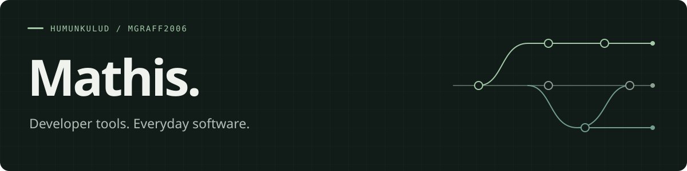

  

I'm **Mathis**, also known as `humunkulud`. I build tools for developers, apps for everyday life, and the Linux setup they run on.

I like systems I can still understand six months later: a real problem, a few moving parts, and something useful at the end.

### Currently building → [Sorrel](https://github.com/MGRAFF2006/sorrel)

**Version control designed for humans and parallel AI agents.** A Rust engine and CLI, a collaboration Hub, and a bidirectional Git bridge. Still in alpha; the [status page](https://github.com/MGRAFF2006/sorrel/blob/main/docs/STATUS.md) separates what works from what's planned.

### More of my work

| Project | The idea | Built with |
| :--- | :--- | :--- |
| [Museum Rodenberg](https://github.com/MGRAFF2006/museum-rodenberg) | Bring local history online: exhibitions, artifacts, QR lookup, and seven languages. | React · TypeScript · Convex |
| [Würfelblock / Kniffeldigi](https://github.com/MGRAFF2006/Kniffeldigi) | Roll real dice. Keep a shared Kniffel or Yatzy scorecard on your phones. | JavaScript · Cloudflare Workers · D1 |
| [4=10 solver](https://github.com/MGRAFF2006/4is10-solver) · [Try it](https://4is10-solver.graff-mathis.workers.dev) | Drag four digits, choose your operators, and make ten. Exact arithmetic, entirely in the browser. | Vanilla JavaScript · Cloudflare |
| [Arch config](https://github.com/MGRAFF2006/config) | Dotfiles, package profiles, setup scripts, and a shared agent kit for my laptop and desktop. | Arch Linux · Hyprland / DWM · Neovim · Zsh |

### My corner of the stack

**Rust · TypeScript · JavaScript** 
React / Solid / Vue · Cloudflare Workers · Docker · Arch Linux · Neovim

Outside developer tools, I keep coming back to judo, maths, and software that makes small everyday jobs easier.

Found something useful here? Issues and feedback belong in the relevant project.
